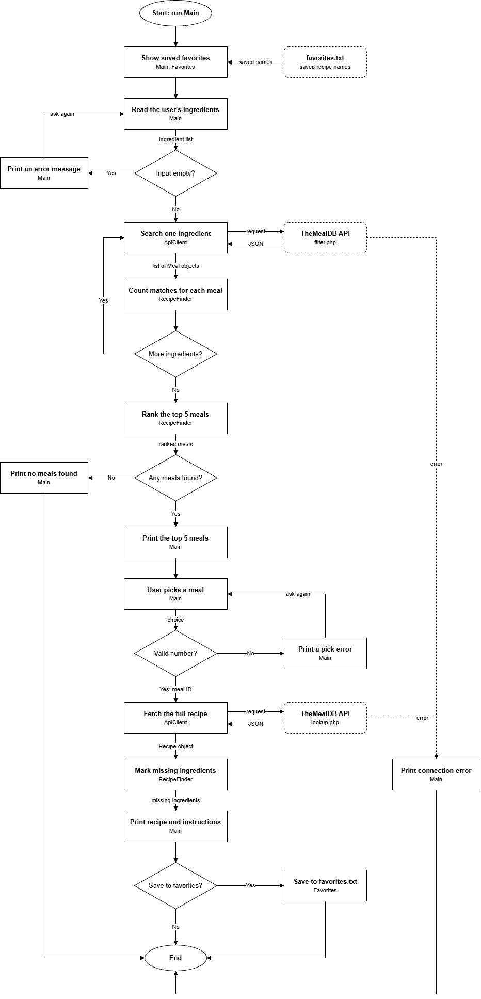

# Recipe Finder

A command-line Java program that takes the ingredients you have and ranks the meals you can make with them.

## The Problem

Whenever I am home, I often have ingredients lying around, but it's hard to figure out what I can actually make with them. Looking up recipe websites makes me search for foods with one ingredient at a time and then compare the results myself, which takes up too much time. I want a program that takes the ingredients I have and shows meals that I could make with them.

## How It Works

1. You enter the ingredients you have separated by commas
2. The program searches TheMealDB for meals that use each ingredient
3. It counts how many of your ingredients each meal uses and shows the top 5
4. You pick a meal and it shows the full recipe with the ingredients you are missing marked

The code is split into 5 classes:
- `Main`: reads input, prints results, and handles errors
- `ApiClient`: sends requests to TheMealDB and turns the JSON into Java objects
- `RecipeFinder`: counts and ranks meals and finds missing ingredients
- `Meal` and `Recipe`: hold the data for a search result and a full recipe



## Tech Stack

- **Language:** Java 11 or newer
- **Library:** [Gson](https://github.com/google/gson) 2.11.0 for reading JSON (included in `lib/`)
- **Built-in Java libraries:** `HttpClient`, `Scanner`, `HashMap`, `ArrayList`, `Collections`
- **API:** [TheMealDB](https://www.themealdb.com/api.php) (free, no account or key needed)
- **Data storage:** none, everything is kept in memory while the program runs
- **Tools:** Git and GitHub

## Setup

**1. Install Java 11 or newer.** Check that it's installed:
```
java -version
javac -version
```

**2. Clone the repo:**
```
git clone https://github.com/Bestakdv/recipe-finder.git
cd recipe-finder
```

**3. Compile:**
```
javac -cp "lib/gson-2.11.0.jar" -d out src/Main.java src/ApiClient.java src/Meal.java src/RecipeFinder.java src/Recipe.java
```

**4. Run:**

Windows:
```
java -cp "out;lib/gson-2.11.0.jar" Main
```

Mac/Linux:
```
java -cp "out:lib/gson-2.11.0.jar" Main
```

You need an internet connection because the program gets recipes from TheMealDB.

## Example

```
Enter your ingredients, separated by commas: chicken, rice, onion, garlic

Top meals:
1. Chicken & chorizo rice pot (uses 4 of your 4 ingredients)
2. Chicken Alfredo Primavera (uses 3 of your 4 ingredients)
3. Chicken Handi (uses 3 of your 4 ingredients)
4. Chicken Mandi (uses 3 of your 4 ingredients)
5. Golabki (cabbage roll) (uses 3 of your 4 ingredients)

Pick a meal (1-5): 1

Chicken & chorizo rice pot

Ingredients:
  - 1 tblsp Oil (missing)
  - 1 whole Chicken
  - 1 Large Chopped Onion
  - 1 chopped Red Pepper (missing)
  - 3 Cloves Crushed Garlic
  - 225g Chorizo (missing)
  - 1 tblsp Tomato Puree (missing)
  - 1 tablespoon chopped Thyme (missing)
  - 150ml White Wine (missing)
  - 800ml Chicken Stock (missing)
  - 400g Rice
  - 2 tbs chopped Parsley (missing)

You're missing 8 of 12 ingredients.

Instructions:
step 1
Heat the oil in a large flameproof casserole dish and brown the chicken pieces on all sides ...
```

## Roadmap

- [x] Set up the repo, Gson, and a Hello World program
- [x] Make the first API call and print the raw JSON
- [x] Parse the JSON into Meal objects with Gson
- [x] Read and clean the user's ingredients
- [x] Rank meals by matching ingredients and show the top 5
- [x] Show a meal's full recipe
- [x] Mark the ingredients the user is missing
- [x] Handle empty input, no meals found, bad meal picks, and no internet
- [ ] Save favorite recipes to view them later
- [ ] Export missing ingredients as a shopping list
- [ ] Filter results by cuisine or category
- [ ] Ignore common staples (salt, pepper, water) when ranking, so they don't outweigh main ingredients

## Demo

Video walkthrough: coming soon